# Flowly

**Flowly** — the agent-native workflow for Paseo.

**English** · [简体中文](README.zh-CN.md)

**A Paseo plugin that turns agent sessions into a workflow that runs itself, with a kanban board as its face.** You hand out work, make the calls, and review. Progress, reminders, summaries, follow-up ideas and daily stats are kept up to date by the board.

> Plugin ID `flowly` · requires Paseo `>=0.11.2` · runs on desktop, tablet and phone clients.

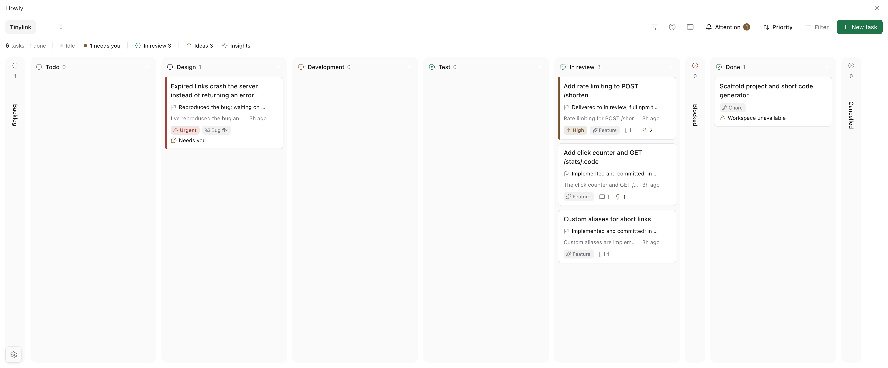

<details>
<summary>Dark theme</summary>

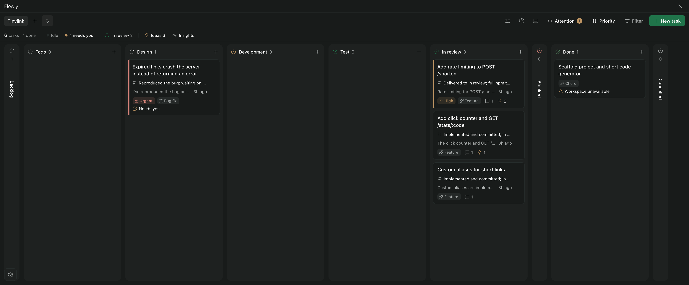

</details>

## Install

```sh
paseo plugin add jasprw/flowly
```

This installs the version reviewed in the [Paseo plugin registry](https://paseo.sh/plugins). The package is also on npm as [`paseo-flowly`](https://www.npmjs.com/package/paseo-flowly) (`paseo plugin add npm:paseo-flowly`). To install the latest `main` straight from Git instead, use `paseo plugin add git:JasprW/flowly`.

Open **Flowly** from Paseo's sidebar. The daemon needs the `paseo` CLI on its path to register a new native project.

## Highlights

### 1. Automatic status flow

Start a session from a card and the card follows the work: **Design → Development → Test → In review**. The agent sets its stage through scoped Kanban tools; the daemon also moves cards when a session starts or resumes a turn. A finished turn never marks a card Done. Done and Cancelled stay your decision. Cards show running, finished, unread and needs-attention session counts, and the latest agent output. Cards that finished more than 14 days ago (configurable in *Settings → Workflow*) fold under **Show older** at the bottom of Done and Cancelled, so the board stays about current work.

Turn it off globally (*Settings → Moving cards*) or per project.

### 2. Needs-you reminders

When an agent needs a decision it asks one clear question and stops. The card lights up **Needs you**, the **Attention** dropdown and the sidebar badge count it, and **Reply** jumps straight to that session. Approvals and errors are surfaced the same way. Questions an agent asks with its ask-user tool, and approvals, can be answered right on the card's detail page or in the Flowly session.

When a turn ends, the agent can leave its **suggested next steps** ("Verify with Luna", "Commit and push") above the session's message box. Tapping one only fills the box; you edit it or send it yourself. Once the work is committed and pushed, an agent can also offer **Move to Done**: that one doesn't fill the box, tapping it moves the card (Done stays your decision). They disappear once your next message starts a new turn.

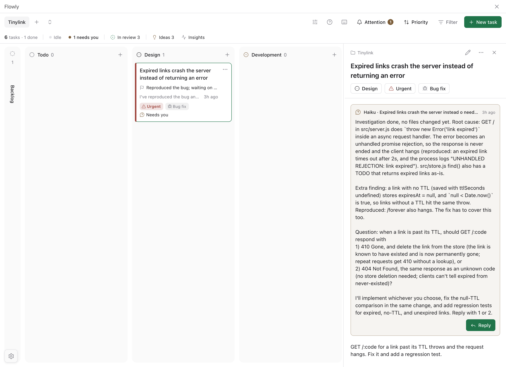

### 3. Run summaries

After every completed turn a cheap model (Haiku 5.5 by default, configurable) updates the card's **state / target / recap / next**. Past versions are kept, so you can still see how far a card got after it is Done. Summaries never change the card's status.

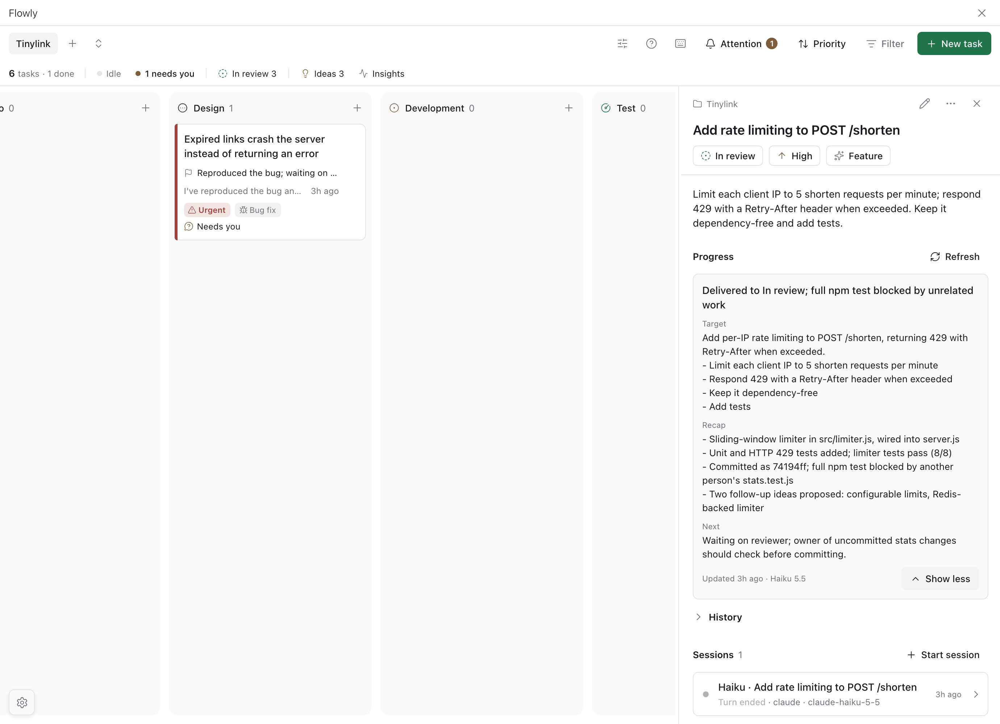

### 4. Follow-up ideas

Work an agent discovers along the way (a bug it tripped over, a limitation, the next step) lands in the project's **Ideas** inbox instead of being lost in a chat. **Good idea** gives you two paths: continue in the same session, or start a new card or new session with the context pre-filled. **Not now** dismisses it. Agents never create cards or start work on their own.

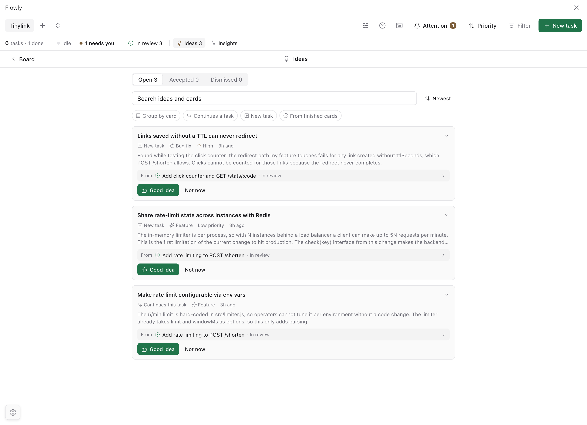
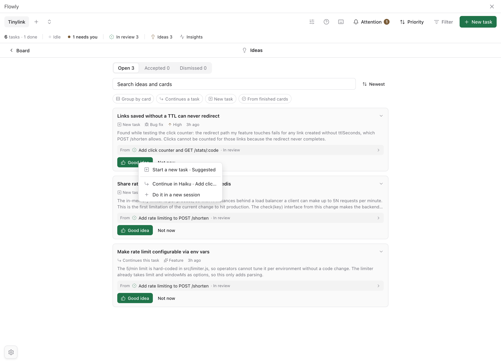

### 5. Inputs and outputs

Each card has an **Artifacts** list: the documents, links and deliverables it worked from (inputs) and produced (outputs). Agents register them through the board tools as they work; you add, edit or remove your own from the card. Only references are stored; files stay where they are and open in a read-only preview. Every entry shows whether you or an agent added it, and agents can't remove the ones you added.

Cards can carry **tags** for the modules and directions they touch (`drawer`, `performance`, `a11y`), separate from the fixed task type. Agents tag their own cards through the board tools and reuse the project's existing tags; you add or remove tags in the card or the form. Filter the board by tag, or search `#tag` (`#module/` matches a prefix). Agents can't remove tags you added.

### 6. Project insights

One page for the day: cards done, new and reworked, turns, agent time, commits and tokens (with cache hit rate), the list of what is **waiting on you**, rule-based suggestions, an AI-written daily summary, per-card token use and a 7-day trend.

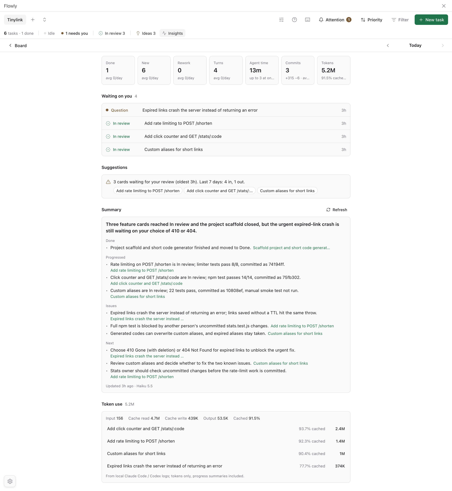

<details>
<summary>Dark theme</summary>

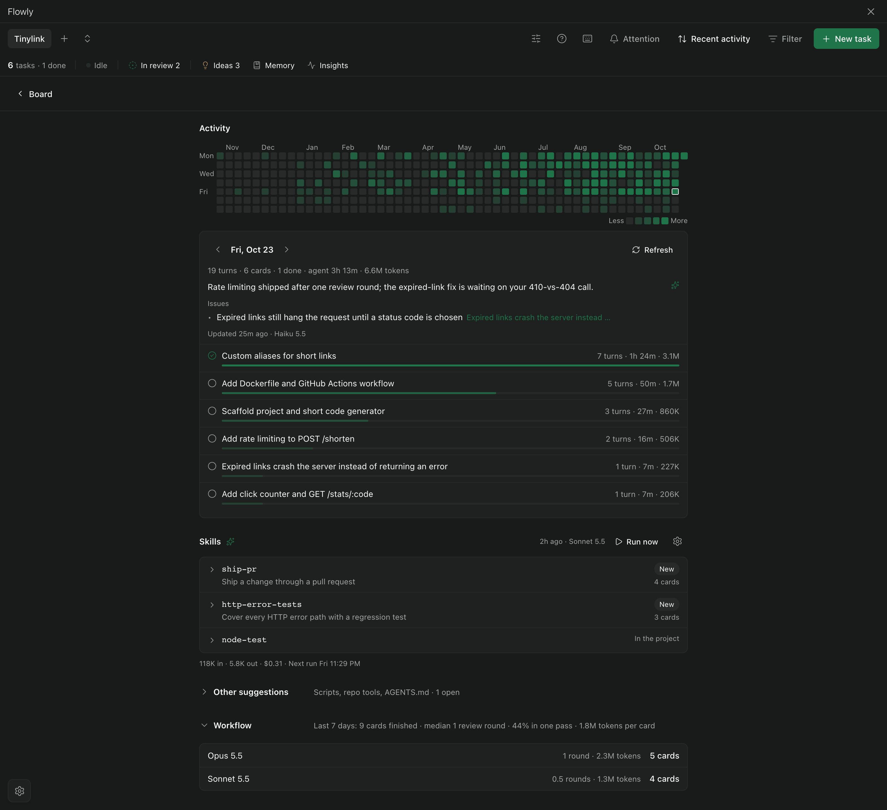

</details>

## Languages

The interface follows your device language, or pick one in **Flowly settings → Language**: English, 简体中文, 繁體中文, 日本語, 한국어, Español, Français, Deutsch, Português (Brasil) and Русский. Agent instructions, daemon error details and the text agents and summaries write are not translated.

| 日本語 | Deutsch |
| --- | --- |
| 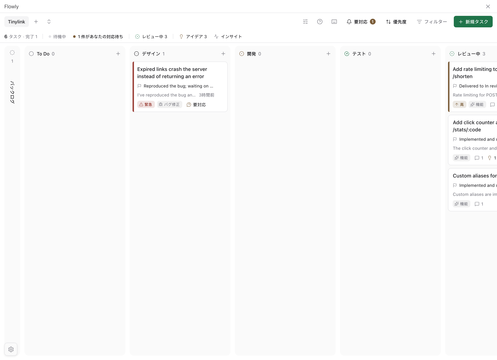 | 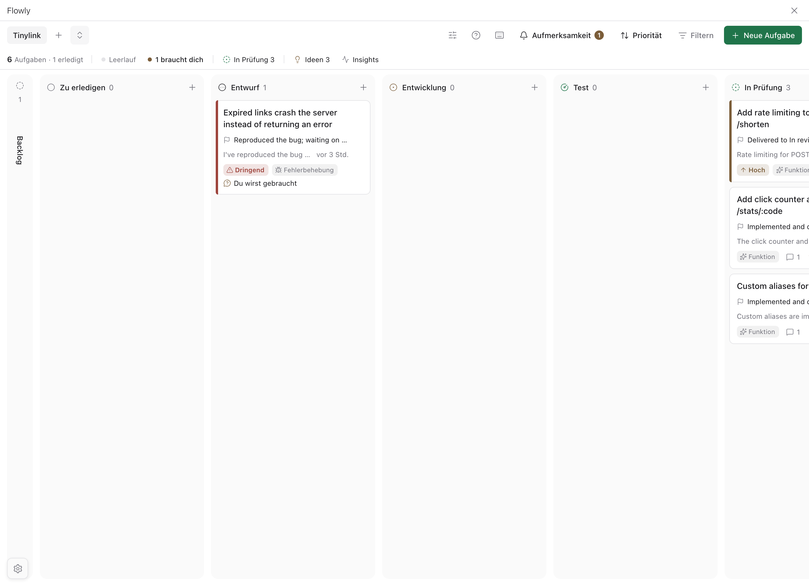 |

## Quick start

1. **New project**: pick a directory (or several repositories) to register as a native Paseo project.
2. **New task**: describe the work; optionally start an agent together with the card.
3. Watch the card move. Answer **Needs you** cards, review **In review** cards, accept or dismiss **Ideas**, and open **Insights** at the end of the day.

## How it works

- **One board project = one native Paseo project root.** To work across repositories, put them under one directory and register it, or let the plugin create a linked root with one symlink per repository (removing a link never touches the target).
- **One card = one workspace**, with any number of sessions in it. You choose which session receives an instruction; ordinary follow-ups send exactly what you type.
- **Agent tools.** Sessions created from a card get scoped MCP tools: `kanban_get_task`, `kanban_update_status`, `kanban_report_progress`, `kanban_propose_idea` and `kanban_suggest_next_moves`, plus a skill that explains them. An agent can move its card between the work stages and In review; a person decides Done and Cancelled. A CLI fallback is provided for sessions without MCP.
- **Card status and session status are independent.** A turn ending never completes a card.
- **Also included:** drag and drop (including within a column), card links (follow-up, blocks, related), task types and priorities, wrap-up of Done cards (archive their sessions and own workspace, after a preflight), keyboard shortcuts (`?`), per-card token usage, and a compact phone layout.

### Models

Pick the model new sessions start with under **Settings → Models**. A project can set its own default in its settings, which wins over the global one; with neither, new sessions start from the latest session's settings.

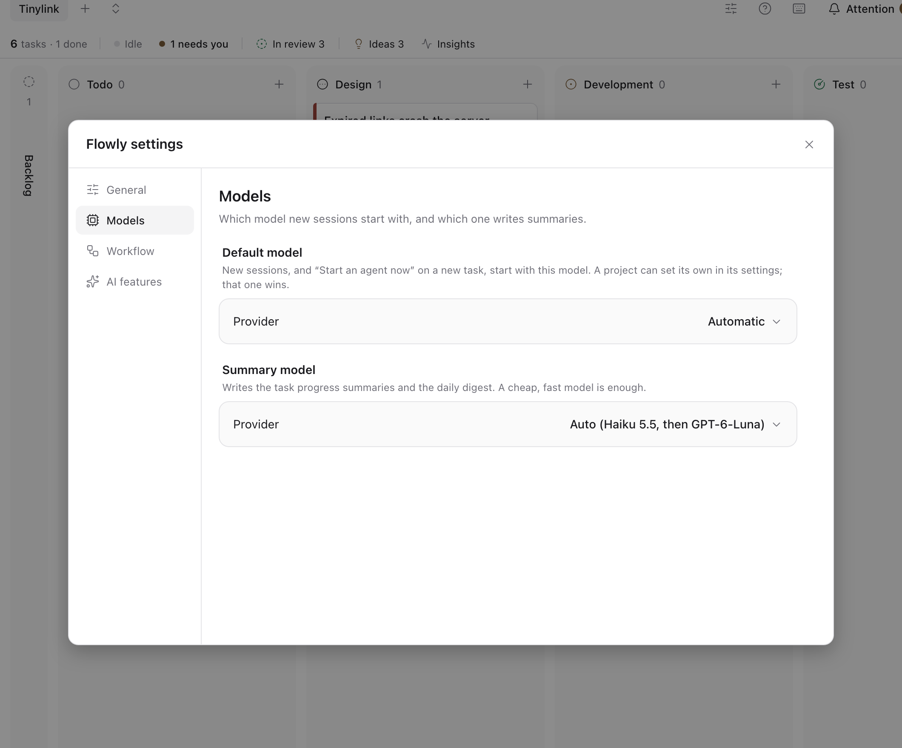

### Data and safety

Board data is stored on the daemon machine in `~/.paseo/plugin-data/flowly/` (`PASEO_HOME` selects the daemon home). Writes are serialized and atomic, stale edits are rejected, and invalid files are preserved rather than reset. Removing or permanently deleting a project or card writes a backup to `removed/` first. Archiving plugin records never deletes Paseo resources or directories. The tool service listens on loopback with private per-session credentials.

## Development

To run from a checkout (for development):

```sh
git clone https://github.com/JasprW/flowly.git && cd flowly
npm install
paseo plugin install "$PWD" --id flowly
paseo plugin reload flowly   # after later changes
paseo plugin logs flowly
```

```sh
npm run typecheck
npm test
```

Releases run through the Makefile: `make help` lists the steps, and `make release VERSION=x.y.z DRY_RUN=1` previews a full release (checks, version bump, tag, push, npm publish, GitHub release). Every outward step asks first.

To add or change text, wrap it in `t()` / `tn()` and add the translation to every file in [`shared/i18n/`](shared/i18n/); `npm test` lists what is missing. See [`docs/I18N-SPEC.md`](docs/I18N-SPEC.md).

Root code is limited to `index.client.tsx` and `index.server.ts`; everything else lives in `client/`, `server/` and runtime-neutral `shared/`. Design decisions, specs and acceptance evidence are in [`docs/`](docs/): start with [`SPEC-OUTLINE.md`](docs/SPEC-OUTLINE.md), [`SINGLE-ROOT-SPEC.md`](docs/SINGLE-ROOT-SPEC.md) and [`PROGRESS.md`](docs/PROGRESS.md). Project rules for contributors and agents are in [`AGENTS.md`](AGENTS.md). Release and promo material (copy, demo project script, screenshot script) lives in [`docs/promo/`](docs/promo/README.md).

## License

[MIT](LICENSE) © 2026 Bofan Wang

The separately installed `paseo-kanban` plugin is a different plugin and is never overwritten.
