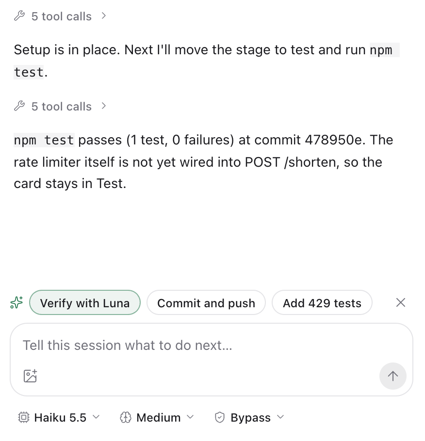

<h1>
  <picture>
    <source media="(prefers-color-scheme: dark)" srcset="docs/brand/logo/flowly-lockup-dark.svg">
    
  </picture>
</h1>

**Flowly**——给 Paseo 的 agent 原生工作流。

[English](README.md) · **简体中文**

**Flowly 是一个 Paseo 插件：把 agent session 变成会自己运转的工作流，看板是它的界面。** 你只管派活、拍板、验收；进度、提醒、总结、后续想法和数据复盘由看板自动维护。

> 插件 ID `flowly` · 需要 Paseo `>=0.11.2` · 支持桌面、平板和手机客户端。


<details>
<summary>深色主题</summary>


</details>

## 安装

```sh
paseo plugin add jasprw/flowly
```

这会安装 [Paseo 插件库](https://paseo.sh/plugins) 里审核通过的版本。也发布到了 npm，包名 [`paseo-flowly`](https://www.npmjs.com/package/paseo-flowly)（`paseo plugin add npm:paseo-flowly`）。想直接从 Git 安装最新的 `main`，用 `paseo plugin add git:JasprW/flowly`。

在 Paseo 侧边栏打开 **Flowly**。daemon 所在机器的 PATH 里需要有 `paseo` CLI，用于注册新的原生 project。

## 主要功能

### 1. 自动状态流转

从卡片启动 session 后，卡片会跟着工作走：**Design → Development → Test → In review**。agent 通过受限的 Kanban 工具设置自己所处的阶段；session 开始或恢复一轮时，daemon 也会移动卡片。回合结束**不会**把卡片设为 Done，Done 和 Cancelled 永远由你决定。卡片上显示运行中、已结束回合、未读、需关注的 session 数量，以及最近一条 agent 输出。

可在 *Settings → Moving cards* 全局关闭，也可以按项目关闭。

### 2. 人工介入提醒

agent 需要你拍板时，会提出一个明确的问题并停下。卡片亮起 **Needs you**，顶部 **Attention** 菜单和侧边栏角标都会计数，点 **Reply** 直达对应 session。授权请求和报错也以同样方式提示。一时拿不定主意时，可以把卡片从 Attention 中 **Dismiss**：计数随之减少，卡片上的提示照常显示，一有新情况就会自动回来。

回合结束时，agent 可以在 session 输入框上方留下**建议的下一步**（如“用 Luna 验证”“提交并推送”）。点一下只会把内容填进输入框，由你修改或自行发送。工作提交并推送后，agent 还可以给出 **Move to Done**：它不填输入框，点击即移动卡片（Done 仍由你决定）。你发出下一条消息、开始新一轮后，这些建议就会消失。

**评论**直接写在卡片上，像 Multica 的 issue 评论：在卡片的 **Comments** 里问进度、提意见或要求修改，不必先找到对应的 session。评论保存在卡片上（出现在 Activity 里，agent 在 `flowly_get_task` 中能看到最近的评论），原文通过与 session 输入框相同的路径、按同一个 *When running* 偏好发给卡片的 agent：默认发给自动化的执行者，否则发给最近活跃、不是评审者的 session；**To:** 可以改选。还没有 session 的卡片先保存评论，agent 启动后会读到；发送失败时评论也已保存，可以 **Resend**。评论不会移动卡片，Done 仍由你决定。




### 3. 任务运行 summary

每轮成功结束后，一个低成本模型（默认 Haiku 5.5，可配置）会更新卡片的 **状态 / 目标 / 已完成 / 下一步**。历史版本全部保留，卡片 Done 之后仍能回看当时做到哪一步。summary 不会改变卡片状态。


agent 还会在卡片上维护一份 **Workpad**：验收标准、它跑的验证项（通过、失败或未运行，各自标明在哪个 commit 上跑、用的什么命令），以及卡片里让它困惑的地方。计划直接取自 agent 自己的待办列表。卡片上显示 **验证 3/5**；在比当前 HEAD 更旧的 commit 上跑的验证会标为*已过期*。你也可以自己勾选验收标准、改验证状态。agent 开工前会先设好卡片的类型和标签并写好 Workpad；没设好之前，每次调用 Flowly 工具的结果都会提醒它。带着未完成项、或缺类型/标签/Workpad 交付到 In review 时，agent 必须明确确认并附上说明；有未完成项时卡片随后标出 **交付时 N 项未完成**。可在项目设置的 *Card workpad* 里按项目关闭。

### 4. 任务延伸 ideas

agent 工作时发现的后续事项（顺带发现的 bug、现有方案的局限、下一步）会进入项目的 **Ideas** 收件箱，而不是淹没在对话里。点 **Good idea** 有两条路：在原 session 里继续，或者带着预填好的上下文新建卡片 / 新开 session；**Dismiss** 则忽略。Ideas 是给你的建议；必须做的工作则由 agent 建成卡片或子卡片（见下文）。


需要比卡片活得更久的东西进入**项目记忆**：你做的决策（包括否决的方案）、踩过的坑和走不通的路、你希望怎么做事，以及相关的人和系统。agent 用 `flowly_remember` 提出候选；卡片移入 Done 时，一个便宜的模型还会复盘它，最多再提 1 条，而且只提跨卡通用的。所有条目都要你在项目的 **Memory** 页（快捷键 `M`）确认后才生效。确认过的条目会进入这个项目新 session 的初始指令（放得下就全部给，放不下就给置顶的和最相关的，其余由 agent 用 `flowly_recall` 查）。每条都可以修改、置顶、归档或删除，也可以复制成 `AGENTS.md` 规则；可以按项目关闭。记忆只存在本机，不进仓库。

### 5. 输入与产出

每张卡有一个 **Artifacts** 列表：它依据的文档、链接（输入）和产出的交付物（输出）。agent 工作时通过看板工具登记，你也可以在卡片上添加、编辑或删除自己的条目。只保存引用，文件留在原处，以只读预览打开。每条都标明是你还是 agent 添加的，agent 不能删除你添加的条目。

**工单、文档和 PR** 也可以作为输入：Jira 工单、Confluence 页面，以及 GitHub、GitLab 的 issue、pull request 和 merge request。在 Settings → Connections 连接服务（自建或云服务，使用个人访问令牌或 API token），然后用 **From Jira / From GitLab / …** 新建卡片，或用卡片 Artifacts 里唯一的 **+** 添加条目。选择器列出你最近的条目（指派给你的、等你审查的、你编辑过的页面），可按编号、链接、数字或标题关键词搜索；GitHub 和 GitLab 会先搜索项目自己的仓库（从 git remote 识别）。agent 用 `flowly_read_external` 读取条目（描述或页面内容、评论，PR/MR 还有分支、head commit 和改动文件名），并能发现条目的变化。Flowly 只读：不评论、不 approve、不合并、不修改任何内容，条目状态也不会移动卡片。令牌只保存在 daemon 所在机器上。

agent 理解任务后会自己补全卡片元数据：卡片没有**任务类型**时设置类型（feature、bugfix、research、refactor、docs、chore），不会覆盖你已选的类型；同时添加描述所涉模块和方向的**标签**（`drawer`、`performance`、`a11y`），与固定的任务类型分开。agent 会复用项目已有标签而不是另造同义词；你可在卡片或表单里添加、删除标签。可按标签筛选看板，或搜索 `#tag`（`#module/` 匹配前缀）。agent 不能删除你添加的标签。

### 输入一次，agent 开始工作

新建卡片只输入一份任务说明，默认启动 agent。agent 整理标题、描述、类型和标签，原始任务原文保留。“更多选项”里可以选择工作区、调整元数据，或暂不启动这一张卡。“编辑项目”提供默认模型、实现者和评审者的模型、推理、权限与受支持的速度设置。开启 Agent automation 后，“创建并启动”进入受监督队列，父卡可以等待子卡并在它们结束后被唤醒。

### 6. 智能体自动化（可选）

在“编辑项目”里打开 **Agent automation**，然后在卡片上选择 **Run with agent**。Flowly 把卡片排进队列：阻塞它的卡片都 Done、项目还有空闲名额时（优先级高的先），在卡片自己的 workspace 里启动一个 agent，并像 Hermes Kanban 监督 worker 那样监督它：一轮结束却没有交付、提问或 blocker 时提醒，失败的回合退避重试，次数用完就把卡片移到 Blocked 并写明原因。设置了 **reviewer** 模型时，每次交付先由第二个 agent 在同一 workspace 里评审：通过则卡片留在 In review 等你，否则把具体修改意见发回实现者，最多进行你设定的轮数。还可以给实现者和评审者各设一个**备用模型**：模型报告频率或用量上限时，由备用模型的新 session 接手（实现者从 workpad 和 workspace 接着做，评审者重做这一轮），不必等上限重置。卡片上会显示 agent 正在做什么（Agent working、Agent reviewing、Agent waiting for you、Agent review passed）；提问照样以 Needs you 找你。Done 仍由你决定。自动化不归档 session，也不主动打断：session 忙时它用 steer 而不是打断；但 Paseo 0.12 没有只在空闲时发送的接口，消息恰好撞上你刚开始的回合、又无法 steer 时，仍可能打断它（限制见 [AUTOMATION-SPEC](docs/AUTOMATION-SPEC.md) §10）。

**卡片与子卡片**（类似 Multica 的 sub-issue）：一张卡对一个 session 来说太大时，agent 会用 `flowly_create_card` 把它拆成子卡片，每张有自己的 workspace，可以用 *blocked by* 排顺序，可以立即开始或先搁置；其它必须做的工作也会建成独立卡片。父卡片显示 **子卡片 2/3**；在自动化下它等待时不占名额，等所有子卡片都停下后被唤醒，拿到每张子卡片的泳道、状态和分支，再验收已交付的（`flowly_update_card`）、启动下一批或自己交付。你也可以在任意卡片菜单里用 **新建子卡片** 手动添加。项目不是 git 仓库时，卡片共用项目文件夹：自动化不会在另一张卡的自动化 agent 正在工作的目录里再启动 agent，但它看不到你自己开的 session，这部分需要你自己协调（或使用 git 项目，每张卡有自己的 worktree）。

### 7. Project insights

一页看完当天：完成 / 新建 / 返工的卡片数、回合数、agent 时长、commits、token（含缓存命中率）；**等你处理**的列表、基于规则的建议、AI 生成的日报、每张卡的 token 用量和 7 日趋势。


<details>
<summary>深色主题</summary>


</details>

**Agent 使用习惯**（始终开启，不花 token）：Insights 页的一个小区块，按天和按模型显示最近 7 天 agent 交付时带下一步建议和 ideas 的比例、你采纳了多少条建议；某个模型或 session 在 10 次以上交付里一次都没有时会标出，规则失效当天就能看到。

**Workflow insights**（可选，默认关闭）：Flowly 会记录 agent 在卡片上执行的 shell 命令（已脱敏），并按你设定的周期（token 充裕可以每天，不充裕可以拉长到每两周），用你选的模型分析最近一周的记录，建议值得沉淀的东西：`paseo.json` 脚本和 worktree setup、agent 反复用内联代码完成的工作可以做成的仓库小工具、AGENTS.md 规则和 skill。每次运行的结果会替换上一次的建议，列表只反映最近一次分析；每条建议一键生成卡片；没有新活动的周期直接跳过，不调用模型。agent 的任务上下文会列出项目 `paseo.json` 中的脚本，让它直接运行，不再手敲命令。

## 界面语言

界面默认跟随设备语言，也可以在 **Flowly 设置 → 语言** 中手动选择：English、简体中文、繁體中文、日本語、한국어、Español、Français、Deutsch、Português (Brasil)、Русский。智能体指令、守护进程的错误详情，以及智能体和摘要所写的内容不会被翻译。

| 日本語 | Deutsch |
| --- | --- |
|  |  |

## 快速上手

1. **New project**：选择一个目录（或多个仓库），把它注册为原生 Paseo project。
2. **New task**：描述要做的事，可以同时启动第一个 agent。
3. 看卡片自己移动。回答 **Needs you** 的问题，验收 **In review** 的卡片，处理 **Ideas**，一天结束时打开 **Insights**。

## 工作方式

- **一个看板 project 对应一个原生 Paseo project 根目录。** 要跨多个仓库工作，可以把它们放进同一个父目录并注册该目录；也可以让插件建一个“链接根目录”，里面为每个仓库放一个软链接（移除链接不会动目标目录）。
- **一张卡对应一个 workspace**，workspace 里可以有多个 session。由你选择哪个 session 接收指令；普通追问只发送你输入的原文。
- **Agent 工具。** 从卡片创建的 session 会获得受限 MCP 工具：`flowly_get_task`、`flowly_update_status`、`flowly_report_progress`、`flowly_propose_idea`、`flowly_suggest_next_moves`、`flowly_set_tags`、`flowly_set_type`、`flowly_add_artifact`、`flowly_remove_artifact`、`flowly_update_workpad`、`flowly_read_external`（`flowly_read_ticket` 作为旧 session 的别名保留），`flowly_create_card` 与 `flowly_update_card`（卡片与子卡片），智能体自动化的评审 session 另有 `flowly_submit_review`，以及说明它们用法的 `flowly` skill。agent 可以在工作阶段之间和 In review 之间移动自己的卡片；Done 与 Cancelled 由人决定。交付或提问的那次调用（`flowly_update_status`、`flowly_report_progress`）还可以带上 `nextMoves`，即显示在输入框上方的建议下一步；没有需要用户做的事就传 `[]`。没有 MCP 的 session 可使用 CLI 兜底。
- **卡片业务状态与 session 执行状态相互独立。** 一轮结束不代表卡片完成。
- **其他能力：** 拖拽（含列内排序）、卡片关联（follow-up、blocks、related）、任务类型与优先级、Done 卡片收尾（预检后归档其 session 和自有 workspace）、键盘快捷键（`?`）、按卡片统计 token、手机紧凑布局，以及在 *设置 → 卡片* 中自选看板卡片显示哪些信息（带实时预览）。

### 模型

在 **设置 → Models** 里选择新会话默认使用的模型。每个 project 可以在自己的设置里单独指定，优先于全局；两者都没设时，新会话沿用最近一个会话的设置。


### 数据与安全

看板数据存放在 daemon 所在机器的 `~/.paseo/plugin-data/flowly/`（`PASEO_HOME` 可指定 daemon 主目录）。写入串行化并原子替换，过期编辑会被拒绝，无效文件会被保留而不是重置。移除或永久删除 project / 卡片前会先备份到 `removed/`。归档插件记录不会删除 Paseo 资源或磁盘目录。工具服务只监听本机回环地址，每个 session 使用独立的私有凭据。

## 开发

从本地仓库运行（开发用）：

```sh
git clone https://github.com/JasprW/flowly.git && cd flowly
npm install
paseo plugin install "$PWD" --id flowly
paseo plugin reload flowly   # 之后有改动时重载
paseo plugin logs flowly
```

```sh
npm run typecheck
npm test
```

GitHub Actions 对 PR 和 main 运行 Node 22/24 的类型检查、测试和真实安装包验证。`make release VERSION=x.y.z` 检查已合入的版本并推送 annotated tag，tag 流水线通过 OIDC 发布已验证的 tarball 到 npm，并创建 GitHub Release；`DRY_RUN=1` 预览本地步骤。配置和恢复见 [CI/CD 文档](docs/CI-CD.md)。

新增或修改文案时，用 `t()` / `tn()` 包起来，并在 [`shared/i18n/`](shared/i18n/) 的每个语言文件里补上译文；`npm test` 会列出缺失项。详见 [`docs/I18N-SPEC.md`](docs/I18N-SPEC.md)。

根目录代码只有 `index.client.tsx` 和 `index.server.ts`；其余在 `client/`、`server/` 和与运行环境无关的 `shared/` 中。设计、spec 与验收记录都在 [`docs/`](docs/)：建议先读 [`SPEC-OUTLINE.md`](docs/SPEC-OUTLINE.md)、[`SINGLE-ROOT-SPEC.md`](docs/SINGLE-ROOT-SPEC.md) 和 [`PROGRESS.md`](docs/PROGRESS.md)。给贡献者和 agent 的项目规则见 [`AGENTS.md`](AGENTS.md)。发布与宣传材料（文案、演示项目脚本、截图脚本）在 [`docs/promo/`](docs/promo/README.md)。

## 许可证

[MIT](LICENSE) © 2026 Bofan Wang

另一个单独安装的 `paseo-kanban` 插件是不同的插件，本插件不会覆盖它。
