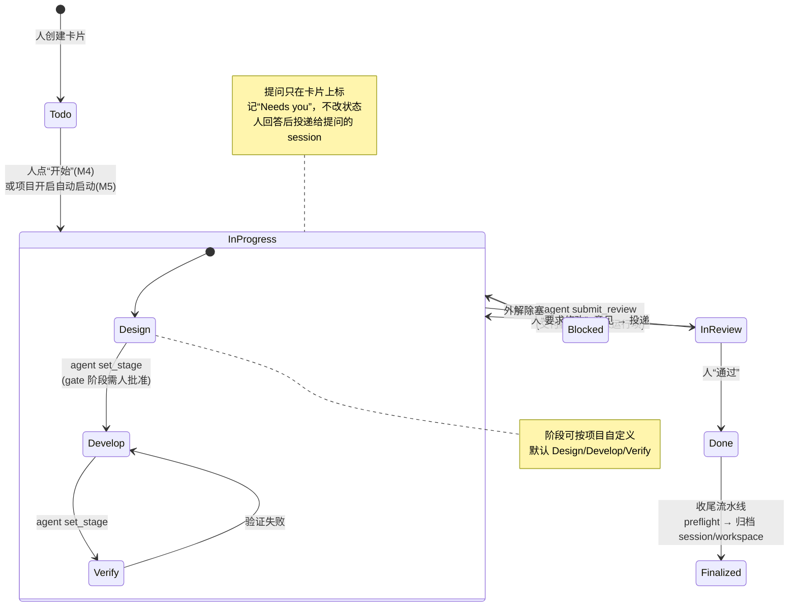

# Ultra Kanban v2 路线图：Paseo 内的人机协作工作流

状态：规划草案，2026-10-14。按第 0 节调整：当前聚焦人工多任务管理；M3 及之后为远期设计（D1–D6 已确认，[PHASE-03-SPEC](PHASE-03-SPEC.md) 暂缓）。各里程碑实施前单独写 spec，并按 AGENTS.md 获得授权。
基线：Phase 1/2、[single-root](SINGLE-ROOT-SPEC.md)、[UI refresh](UI-REFRESH-SPEC.md) 已交付。Multica 的调研结论沿用 [SPEC-OUTLINE §3](SPEC-OUTLINE.md)，并补充了其 README 中的新能力（Inbox、Review gates、Autopilots、Squads、Retries、Usage）。

## 0. 优先级调整（2026-10-14，用户决定，优先于下文）

- **最高优先级**：用看板方便地人工管理多个并行任务。状态以人工调整为主，尽可能简单。
- **agent 自动调整状态是远期目标**，不是当前重点。下文 M3–M6（含 [PHASE-03-SPEC](PHASE-03-SPEC.md)）保留为远期设计，暂缓实施。D1–D6 的结论仍有效，到时直接沿用。
- 现有 agent 工具（`get_task`/`update_status`/`report_progress`）保持可用、不扩展；agent 不调用也不影响使用。
- 下一步改为 **M2.5 多任务人工管理**（见第 8 节），具体范围待用户确认后写 spec。

## 1. 目标工作流

用户创建卡片并点“开始”后，agent 按项目工作流（内置默认，可自定义）推进阶段。需要人回答时只在卡片上标记，不改状态；交付后进入 Review。人确认完成后，系统自动收尾（归档 session 和 workspace）。

| 角色 | 负责 |
| --- | --- |
| 人 | 建卡、开始、回答问题、审核交付、通过或打回、例外处理 |
| Agent | 读取卡片与项目 playbook，切换阶段，汇报进展，遇到需要人的情况主动发起请求，提交 Review |
| 插件 daemon | 校验并持久化；通过 hook 观察 session（授权请求、失败、静默结束）并在卡片上提示；执行收尾流水线；重启后核对状态 |

“Needs you”不是新的业务列，也不改变状态（D2）：卡片保持当前状态，只显示标记和请求数，并进入收件箱。In review 只表示 agent 已交付、等你验收。

## 2. 现状与差距

| 能力 | 现在 | 差距 |
| --- | --- | --- |
| 业务状态 | 7 列；agent 可设 In progress/Blocked/In review；Done/Cancelled 由人设 | 没有阶段（设计/开发/验证）概念 |
| Agent 工具 | `get_task` / `update_status` / `report_progress`，MCP+CLI 共用校验，CAS 与幂等回执 | 缺 `set_stage`、`request_human`、结构化 `submit_review` |
| 需要人 | 卡片只显示 session 未读、授权、错误计数 | 没有“问题+回复”闭环，人的回答无法定向回到提问的 session |
| Review | 移到 In review 后只有一条 note | 没有交付物视图，也没有通过/打回按钮；打回后不会自动续工 |
| 启动 | 侧栏手动建 session，可选 provider/model/mode | 没有一键开始，没有项目级默认 agent/playbook，也没有自动启动 |
| 工具接入 | 侧栏新建的 session 自动带 MCP；已有 session 需手动“发送看板工作指示” | 原生入口新建的 session 不会自动接入（可用 `before("agent.create")` 解决） |
| 完成 | 人设 Done，资源全部保留 | 没有收尾流水线（preflight + 归档） |
| 观察 | turn started/ended、授权请求写入活动；卡片显示汇总 | 没有失败、卡住、静默结束、重启后核对的处理；没有执行历史和成本 |
| 跨卡视图 | 按项目分列 | 没有跨项目的“待你处理”收件箱 |

## 3. 对标 Multica

| Multica 能力 | 在 Paseo 中的对应 | 现状 | 里程碑 |
| --- | --- | --- | --- |
| Assign issue → agent 领取并自行更新状态 | 卡片“开始”/自动启动 + 看板工具 | 部分（需手动建 session） | M4 / M5 |
| Agent 汇报进展、主动报 blocker、完成后移到 review | `report_progress` / `update_status` / `request_human` / `submit_review` | 部分 | M3 |
| Review gates：人批准后才发布 | In review 交付物视图 + 通过/打回 + Git 信息 | 缺 | M3 / M4 |
| Inbox：需要决策时才通知 | 跨项目“待你处理”收件箱 + composer pill/header button 提示 + 原生 agent attention | 缺 | M3 |
| Steer a running agent | 侧栏 Steer/Interrupt 已有 | 已有 | — |
| Execution log | Paseo 原生 timeline + 侧栏预览；卡片级执行历史 | 部分 | M5 |
| Skills（可复用 playbook） | 项目 playbook：分阶段指令、完成定义、验证命令，建 session 时注入；也可复用 Paseo/provider skills | 缺 | M4 |
| Retries & timeouts | daemon watchdog：失败重试、卡住告警、静默结束提醒 | 缺 | M5 |
| Usage analytics | 按卡片/项目汇总 agent usage（取决于 SDK 是否暴露 usage） | 缺 | M5 |
| Autopilots（cron 周期任务） | 插件服务端定时建卡并启动 | 缺 | M6 |
| Squads / 角色路由 | 设计、开发、评审由不同 agent 交接，评审 agent 先于人审核 | 缺 | M6 |
| Projects + repo/docs 作为上下文 | single-root 项目 + playbook + 项目文档 | 部分 | M4 |
| Chat、多客户端、自托管 | Paseo 本身提供 | 由宿主提供 | — |

## 4. 里程碑

### M3 人机闭环（建议下一步）

目标：agent 自己切换阶段、在需要人时发起请求、提交 Review；人在卡片上回答或审核，结果回到正确的 session。

- 数据：task 增加 `stage`（`design/develop/verify` 或 null）和 `requests[]`。request 字段包括 id、kind（`decision/approval/input/review`）、question、options、agentId、createdAt，以及 answer/answeredAt/answeredBy。另增交付记录 `deliverable`：summary、verification、notRun、links、changes。存储 v3 → v4 迁移，保留无效数据而不重置。
- Agent 工具（MCP 与 CLI 同一服务，沿用 CAS 和幂等回执）：
  - `kanban_set_stage(stage, note)`：仅在 In progress 下可用。
  - `kanban_request_human(question, options?)`：记录请求，不改状态，卡片标为“Needs you”。每卡最多 10 个未结请求。
  - 工作流可配置（D1）：项目级阶段列表，每个阶段有说明、退出条件和可选的人审 gate；内置默认，可设为新项目默认。
  - `kanban_submit_review(deliverable)`：结构化交付，卡片移到 In review 并标为“等你验收”。原 `update_status(in_review)` 继续兼容。
- 人侧 UI：
  - 卡片：右上显示“需要你”徽标（warning 色）和问题摘要；阶段以小标签显示在信号行。
  - 侧栏：顶部固定一块“待处理”：问题、选项按钮、回复框；或交付物卡片配“通过 / 要求修改”。
  - 回复或打回：写入卡片并定向投递给发起请求的 session。投递内容带明确的 Kanban 回复标识，属于显式的 Kanban 操作，与普通 follow-up 原样发送的规则区分。回复不改状态；打回时卡片回到 In progress。人点“通过”即设为 Done。
  - 收件箱：工具栏“待你处理 (n)”，跨项目列出所有带未结请求或待验收的卡片。
  - 原生 session 内：现有 composer chip 标签改为显示“需要你”；chip 支持 `popover`，可直接在原生 session 页回答。
- Hook 信号（只提示，不改业务状态）：授权请求和失败 turn 在卡片上提示；卡片处于 In progress 时，turn 结束但本轮没有任何工具汇报，记为“静默结束”。
- Skill：阶段协议、何时必须请求人（不可逆操作、方案取舍、缺信息、超出范围）、交付物格式。
- 验收：一张卡完整走通设计 → 开发 → 提问 → 回答 → 验证 → 提交 → 打回 → 修改 → 通过；覆盖多 session 冲突、重启和重复投递（幂等）。

### M4 启动与收尾自动化

- 一键开始：卡片“开始”按钮按项目 playbook 的默认 provider/model/mode（可选 full-access）建 session，并带上卡片指令，stage 设为 design。
- 自动接入：用 `before("agent.create")` 给在卡片 workspace 中新建的任何 session 注入 MCP 和环境变量。原生入口新建的 session 也自动可用；已存在的 session 仍走显式指示。
- 项目 playbook（对标 Skills）：分阶段指令、完成定义（DoD）、验证命令、是否需要人审方案（design gate）。版本化，在侧栏可查看。
- 收尾流水线（人点“通过”后执行，可按项目关闭）：
  1. Preflight：所有 session 空闲；git 工作区干净；分支已推送或已合并；无未推送提交。结果写到卡片上。
  2. 全部通过且项目策略为“自动”时，归档该卡 session 和 workspace。否则弹确认框，列出未通过项，由人决定。
  3. 只自动归档插件为本卡创建的 worktree workspace。Paseo 归档最后一个引用后会删除 worktree 目录，因此 preflight 必须先过。directory 类 workspace（如项目根）从不自动归档。
  4. 回执写入活动；失败时卡片显示“收尾失败”并可重试；看板卡片保留并标记已收尾。
- Git 交付信息：卡片和侧栏显示分支、ahead/behind、diff stat、PR/MR 链接（通过 `gh`/`glab` 参数数组子进程调用）。CI 状态留待后续。

### M5 自主运行与可靠性

- 自动启动队列（对标 assign + 容量）：项目开启后，Todo 卡按优先级自动开始，最大并发 N，可暂停或恢复。
- Watchdog：running 超过阈值记为卡住；失败 turn 按退避自动重试（上限 n 次）后再提示人；静默结束发一次提醒（可配置）。
- 重启核对：hook 是尽力投递，daemon 启动和周期任务时用 SDK 核对 session 与 workspace 的实际状态，修正卡片提示。
- 执行历史：卡片级记录每个 turn 的 session、开始/结束、结果、耗时，若 SDK 提供则加上 usage/成本；按项目汇总。
- 通知：以 Paseo 原生 agent attention 加插件收件箱为主；可选外部推送（如 SeaTalk webhook）。

### M6 团队化与规模（候选）

- 角色交接（Squads）：设计、开发、评审由不同 agent 担任（可用不同 provider），评审 agent 先于人做一轮自动审查。
- 子卡与依赖，阶段完成自动唤醒下一阶段；规划 agent 把项目目标拆成卡片（原 A3/A4）。
- Autopilot：周期任务（cron）自动建卡并启动。
- 外部同步（Jira/GitLab issue）、跨 host 调度。

## 5. 需要调整的项目约束

以下 AGENTS.md 条款与目标冲突，需要在对应里程碑开始前由用户确认修改：

| 现约束 | 建议改为 | 里程碑 |
| --- | --- | --- |
| “Automatic assignment, multi-agent handoffs, role orchestration… are outside v1” | v2 按里程碑引入：M4 一键开始、M5 自动启动队列、M6 角色交接；每项默认关闭，按项目开启 | M4–M6 |
| “Archiving plugin records … does not implicitly archive/delete Paseo resources” | 人点“通过”后，按项目收尾策略、在 preflight 通过时归档本卡 session 和插件创建的 worktree workspace；其余情况仍不隐式归档 | M4 |
| “ordinary follow-up sends exactly the user's text” | 保持不变。另增显式的“回复请求 / 要求修改”投递类型，带 Kanban 标识 | M3 |
| “A turn ending never automatically completes the card” | 保持不变。turn 事件只产生提示；状态变化只来自 agent 工具调用或人的操作 | — |

## 6. 待确认决策

| # | 问题 | 建议 |
| --- | --- | --- |
| D1 | 阶段固定还是可配置 | **已定**：可配置，内置默认 Design/Develop/Verify，用户可自定义，并可设为新项目默认（M3） |
| D2 | “需要人”用新列还是 In review | **已定**：不改状态，只在卡片上出标记 |
| D3 | 设计方案是否默认需要人审批 | **已定**：默认关闭，按阶段开启 gate |
| D4 | 收尾归档的范围与确认方式 | **已定**：只归档插件创建的 worktree；preflight 全绿自动归档，否则弹确认；directory workspace 不自动归档（M4） |
| D5 | 打回或回复后是否自动续工 | **已定**：是，投递给原 session；打回时卡片回到 In progress |
| D6 | 收件箱是否包含 session 信号 | **已定**：包含，与 agent 的请求分组显示 |

## 7. 下一步

1. ~~确认 D1–D6~~（已完成）。第 5 节的约束修改随对应里程碑实施时写入 AGENTS.md。
2. ~~写 M3 spec~~：[PHASE-03-SPEC](PHASE-03-SPEC.md)，等待实现授权。
3. 实现：typecheck、聚焦测试、reload，再用 full-access 的 `codex/gpt-6-luna` 会话验收并清理 fixture，然后停下来交用户 review。
4. 之后按 M4 → M5 → M6 推进，每个里程碑单独写 spec、单独授权。

## 8. M2.5 多任务人工管理（候选范围，待确认）

只用人工操作和已有的 Paseo session 信号，不新增 agent 工具。

| # | 能力 | 说明 |
| --- | --- | --- |
| A | “需要关注”总览 | 工具栏一个入口，跨项目列出有 session 待处理的卡片：回合结束未读、等待授权、出错；点击直达卡片或 session。完全基于现有信号 |
| B | 一键开 session | 卡片上“Start session”，沿用上次的 provider/model/mode，初始指令默认带卡片标题和描述，可改 |
| C | 卡片按关注度排序/筛选 | 列内可选把需要关注的卡片排前；筛选“有运行中 / 需要关注” |
| D | 手动收尾 | Done 的卡片上“归档 workspace”按钮：先列出检查结果（session 是否空闲、未提交改动、分支是否推送），确认后归档；只针对插件创建的 worktree，directory workspace 只归档看板记录 |
| E | 卡片备注 | 卡片上可追加简短备注，便于人自己记录进度（不投递给 agent） |
